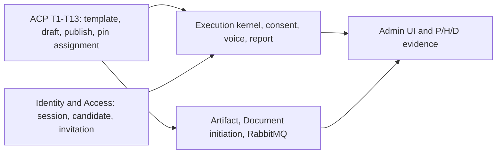

# Yang belum diimplementasikan

Requirement [docs/design/core-ai/technical-design.md](docs/design/core-ai/technical-design.md) adalah desain seluruh platform. Capability [agent-configuration-publication.md](docs/services/core-ai/business/capabilities/agent-configuration-publication.md) hanya memiliki BR-CORE-001–014. Task plan menandai T1–T13 selesai, dan kode sesuai dengan itu.

Yang sudah hidup: katalog kedua template, draf, validasi deterministik, publikasi atomik plus replay, revisi immutable, filter gaji, startup retain-and-restrict, dan `POST /admin/interview-assignments` yang menyalin `active_revision_id` HR Interviewer. Undangan tetap 404 jika `{id}` adalah candidate id; itu perilaku yang diminta BR-CORE-031, dan [interview_assignment_create_test.go](test/integration/interview_assignment_create_test.go) mengujinya.

## Dokumen yang ketinggalan kode

Jangan membaca kalimat ini sebagai pekerjaan yang belum dikerjakan:

- [technical-design.md](docs/services/core-ai/agent-configuration-publication/technical-design.md) §1 dan §11 masih menulis bahwa `POST /admin/interview-assignments` tidak terdaftar, tidak ada di OpenAPI, dan `PinAssignment` hanya dibangun di tes. Route itu sudah dipasang lewat `CreateAssignment` di [infrastructure/runtime/access.go](infrastructure/runtime/access.go), ada di [docs/api/openapi.yaml](docs/api/openapi.yaml), dan dicatat di [docs/api/CHANGELOG.md](docs/api/CHANGELOG.md).
- [decision-log.md](docs/services/core-ai/agent-configuration-publication/decision-log.md) D7 masih bilang route create belum ada. D10 sudah menutup kontrak itu.
- Capability masih `status: planned`, dan open question soal warning serta deployment policy sudah ditutup D5/D8. Warning v1 hanya `CURRENCY_NOT_REQUIRED`, tanpa acknowledgment. Deployment memakai katalog restorasi; binary menolak tuple yang tidak didukung.
- Platform §14 masih mencentang “deployment compatibility policy” sebagai terbuka. Untuk konfigurasi, kebijakan itu sudah T10.

Penyimpangan yang sudah disetujui, bukan lubang: skema memakai SQL manual (bukan AutoMigrate di §5), anggaran HR di konfigurasi adalah 300–600 detik total dengan kapasitas pertanyaan 30 detik (bukan runtime stage 2+4+2 menit), dan create assignment tidak idempoten. Respons 201 yang hilang membuat assignment baru.

## Masih terbuka di batas capability ini

Requirement platform yang menyentuh konfigurasi, tetapi slice ini sengaja belum menyelesaikannya:

- **UI HR/admin.** TD-03 menunda UI. P-01 dan P-02 di scope freeze mensyaratkan perjalanan non-developer. API HR bisa membuat kedua instance; tidak ada layar konfigurasi.
- **GET assignment, revoke, dan report.** §9 meminta `GET /admin/interview-assignments/{id}`, `POST .../revoke`, `GET .../report`, dan `POST .../report-generations`. T13 hanya memasang create. Revoke yang membatalkan wawancara nonterminal juga belum ada.
- **Start eksekusi.** `StartExecution` menyalin revisi yang di-pin, tetapi tidak dipasang di runtime dan tidak punya route. P-05 hanya terbukti di konsumen tipis PostgreSQL ([agent_configuration_binding_test.go](test/integration/agent_configuration_binding_test.go)), bukan pada eksekusi yang sedang berjalan.
- **Master data versi.** Job description dan salary ceiling adalah dua UUID demo di [infrastructure/service/agentreference/local.go](infrastructure/service/agentreference/local.go). Tidak ada CMS. §4 meminta master data berversi yang tidak mengubah eksekusi aktif.
- **Retensi.** §5 meminta artefak 7 hari, metadata 30 hari, orphan 24 jam, dan urutan purge yang kompatibel dengan idempotency key. D2 menunda expiry key publikasi. Tidak ada pembersihan.
- **Observability konfigurasi.** §10 meminta korelasi request/versi dan metrik eksekusi, outbox, serta provider. Slice ini tidak menambah stack itu.
- **Konfirmasi “Why”.** Open question capability yang tersisa adalah konfirmasi produk atas kalimat Why, bukan kode.

## Belum ada sama sekali dari requirement platform

Non-goal capability ini, dan masih wajib sebelum MVP di §13–§14 serta scope freeze:

**Candidate interview (§7, §9 Candidate).** Yang ada hanya landing, exchange, dan `GET /candidate/session`. Belum ada notice/consent, `POST /candidate/executions`, session attempt, ready, takeover, cancel, atau state UI connecting sampai completed/failed.

**HR runtime (§7, H-01–H-12).** Voice yang ada masih prototipe WebRTC terpisah (`GET /voice-session`, `POST /voice-sessions`), tanpa stage, coverage, handoff, checkpoint, transcript otoritatif, reconnect, atau finalisasi. GPT-Live belum terikat ke eksekusi. Laporan tidak menghasilkan hire/reject; lifecycle laporan itu sendiri belum ada. H-12 hanya terjaga di response konfigurasi (`salaryCeilingConfigured`), belum di skenario wawancara.

**Document Analyzer (§8, D-01–D-08).** Subset field bisa dipublikasikan. Belum ada upload artefak, inisiasi yang mengambil active revision, ekstraksi, retry dua attempt, atau hasil valid/missing/invalid. §9 yang belum ada: `POST /admin/artifacts`, `POST /admin/document-executions`, `GET /admin/executions/{id}`, operations, result, dan cancel.

**Kernel dan broker (§3, §5, §6, TD-09).** Belum ada lifecycle `CREATED → RUNNING → COMPLETED/FAILED/CANCELLED`, operation/attempt/fencing, outbox, RabbitMQ, reconciler, atau shutdown yang memulihkan pekerjaan durable. Task queue yang ada tetap untuk Task Tracking.

**Admission bersama (P-06–P-12).** Belum ada inisiasi HR dan Document lewat admission yang sama, deduplikasi eksekusi, transisi terminal, jejak attempt, atau bukti bahwa Kernel tidak memuat aturan stage/invoice.

**Gerbang yang checklist §14 masih buka.** Bukti live S1–S4, identitas event provider, kontrak model dokumen/laporan, topologi antrean, anggaran aktivasi stage berikutnya, format CV di luar seed, penghapusan saat consent ditarik, dan lulus P-01–P-12, H-01–H-12, D-01–D-08.

